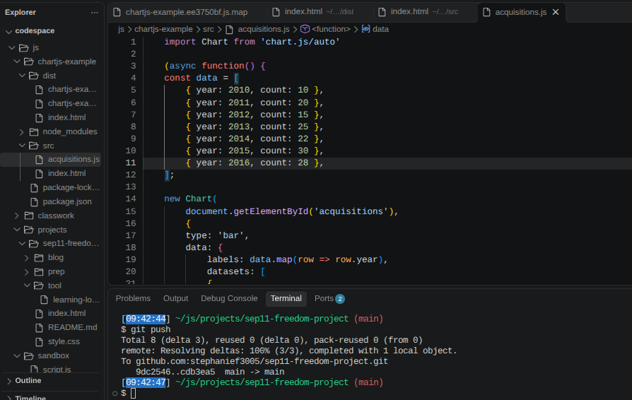
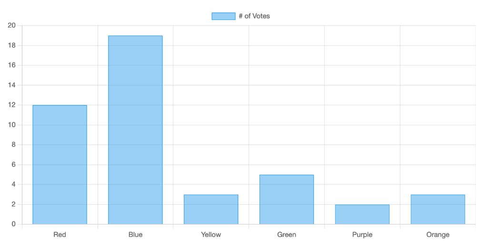
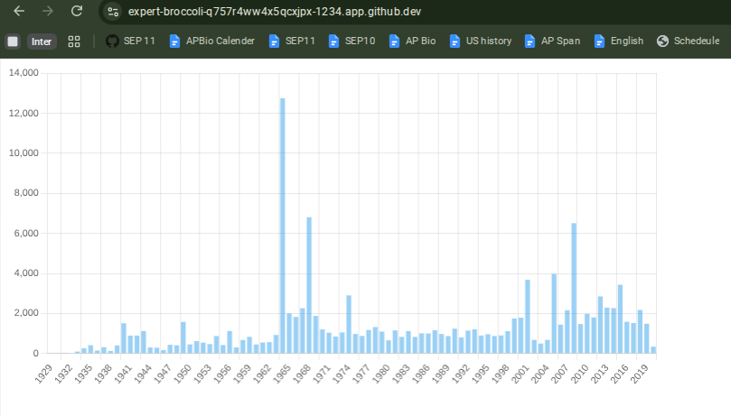

# Tool Learning Log

## Tool: **Chart.js**

## Project: **Earths ecosystem**

---

Start of learning log 2 : 11/2/26-11/9/26
11/2/26

Instead of jumping to the samples I firstly went to the Getting Started Page and I am working on step by step guide first. As suggested. There was many processes to building a chart.js data visualizer. First I started on a simple chart.

What I specifically did according to the steps is I created a seperate folder for tinkering and everything is in this format and each file has the following code that creates my chart. Now I would type everything all but I realized on node_modules its a very long list with characteristics like lightnening and babel.

Takeaways I learned is: 
* the new http-server I use now is npm run dev to preview my chart.
* Chart.js requires instalattions through folders as it says in the [link](https://www.chartjs.org/docs/latest/getting-started/)

11/3/26
Today I continued on the step by step guide continued on simple customization section I learned that.
* Its a more minimalist version
* You can edit it based on if you wanna make it true or false kind of a connection to what we've been learn turns on if its true and turns off if its false.

I also use my IDE to continue the following steps
* In my IDE I repliced the new chart code in src/acquisitations.js with a snippet given too customize the code I put true and false for animations to see the difference it gives.

11/4/26

After working with input data the next step on the step by step guide is to use real world data. So in the Real world data onward section till the other further customizations

I learned that its a software application that shares informations from other sources and can bring back the info my link. Making it called real world data.

11/5/26
So today I finished the rest of it till it says it looks much better now overall I learned how to make 3 different types of charts . My image isnt downloading of the chart so Ill update it soon. I also learned how bubble charts can show 3 dimmensiosn with  x and y axis

<!-- 
* Links you used today (websites, videos, etc)
* Things you tried, progress you made, etc
* Challenges, a-ha moments, etc
* Questions you still have
* What you're going to try next
-->
