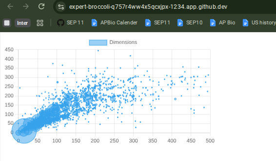

# Tool Learning Log

## Tool: **Chart.js**

## Project: **Earths ecosystem**

---

Start of learning log 2 : 11/2/26-11/9/26
11/2/26

Instead of jumping to the samples I firstly went to the Getting Started Page and I am working on step by step guide first. As suggested. There was many processes to building a chart.js data visualizer. First I started on a simple chart.

What I specifically did according to the steps is I created a seperate folder for tinkering and everything is in this format and each file has the following code that creates my chart. Now I would type everything all but I realized on node_modules its a very long list with characteristics like lightnening and babel.

Takeaways I learned is: 
* the new http-server I use now is npm run dev to preview my chart.
* Chart.js requires instalattions through folders as it says in the [link used](https://www.chartjs.org/docs/latest/getting-started/)

11/3/26
Today I continued on the step by step guide continued on simple customization section I learned that.
* Its a more minimalist version
* You can edit it based on if you wanna make it true or false kind of a connection to what we've been learn turns on if its true and turns off if its false.

I also use my IDE to continue the following steps
* In my IDE I repliced the new chart code in src/acquisitations.js with a snippet given too customize the code I put true and false for animations to see the difference it gives.

[link used](https://www.chartjs.org/docs/latest/getting-started/)

11/4/26

After working with input data the next step on the step by step guide is to use real world data. So in the Real world data onward section till the other further customizations

I learned that its a software application that shares informations from other sources and can bring back the info my link. Making it called real world data.

[link used](https://www.chartjs.org/docs/latest/getting-started/)

11/5/26
Today I worked on a new type of chart called real world data. In order to get that done with I did the following
* In my chart js example file in src/api.js I input it with the step by step guide following contents which connected to an a data api from cube js we use the api to connect with a public data base where we got our information for our chart. In the code they fetch data by getAqusitionsByYear: returns us the number of artworks by the yearr. getdemensions: will be used to return number of artwork by measurements for a other chart. In the code measures gives us count of artworks. We call the api then map it to an array with properties like year and count . This can be essential to know for my freedom project. When getting data of electricity use population etc.
* getAqusitionsByYear is plugged back in to const data in src/acquisitations.js to define the data variable so its plugged in the graph since we are working with a different chart
* Below is a picture of the results from my terminal after running with npm run dev

[link used](https://www.chartjs.org/docs/latest/getting-started/)

11/6/26
Continuation on the step by step guide on [link used](https://www.chartjs.org/docs/latest/getting-started/).

In the step by step guide we are working with a different type of chart bubble charts with the same api data from yesterday.
* I create a new file called dimensions.js in the src folder with a code snippet.
* In order to choose which type of chart we are working with  within the new chart the type has to be bubble. Within it  there is the maps using the x and y axis and radius properties
* rm -rf .parcel-cache = used in terminal to reset cache when switching with chart used
* I used npm run dev but it still showed yesterdays code therefor I commented all of yesterdays data set ran it again and the bubble chart worked

<!-- 
* Links you used today (websites, videos, etc)
* Things you tried, progress you made, etc
* Challenges, a-ha moments, etc
* Questions you still have
* What you're going to try next
-->
